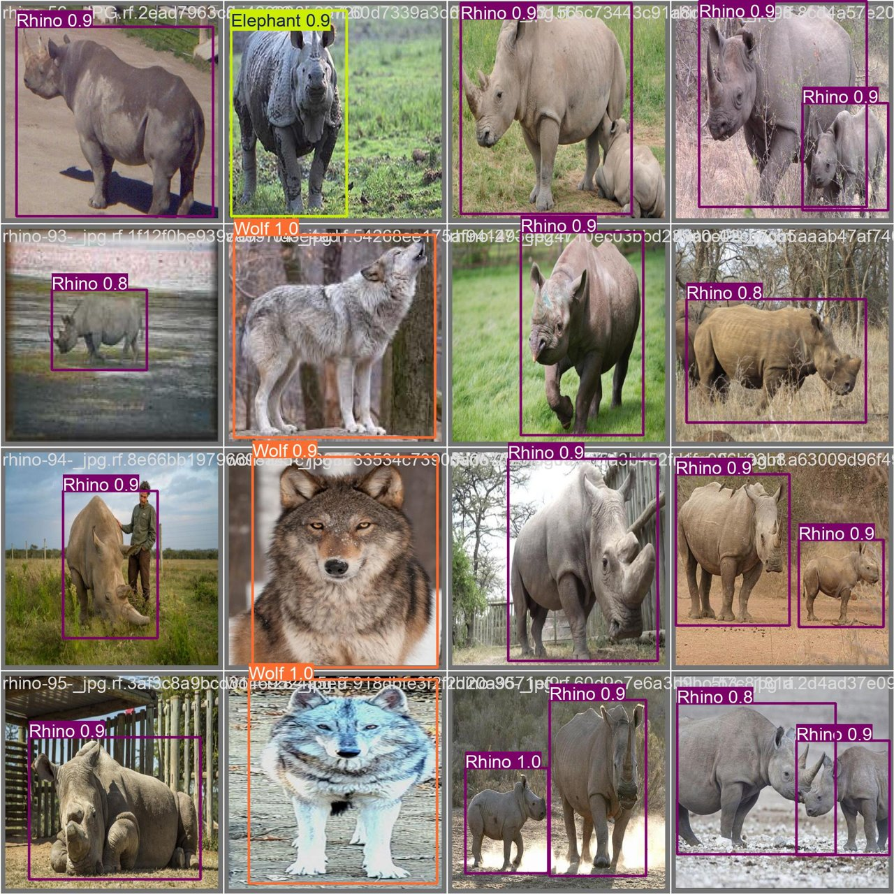

# Multi-Class Animal Detection (YOLOv8n)

Object detection for 20 animal species with YOLOv8n, fine-tuned on a 2,000-image dataset that our team collected and labelled in Roboflow. It comes with a small Streamlit app: upload a photo and it draws a box around each animal it recognises.


*Predictions on held-out test images. Second image, top row: a one-horned rhino detected as "Elephant". The model doesn't always get it right.*

## Results

Measured on the **test split**, which was never used for training or for choosing the best epoch.

| Evaluation set | Images | Boxes | mAP@50 | mAP@50-95 | Precision | Recall |
|---|---|---|---|---|---|---|
| Test split | 300 | 388 | **0.873** | 0.648 | 0.880 | 0.792 |
| Test split without duplicates (see below) | 286 | 371 | **0.864** | 0.636 | 0.852 | 0.802 |
| Validation split (used to pick the best epoch) | 300 | 412 | 0.850 | 0.622 | 0.842 | 0.771 |

- **mAP@50** counts a predicted box as correct when it overlaps the true box by at least 50%. **mAP@50-95** averages over stricter overlaps (50% to 95%), so it also rewards tight boxes.
- **Duplicates:** the images were collected from the web, and 14 of the 300 test images turned out to be near-copies of training images (the same photo saved twice under different names). Removing them lowers mAP@50 from 0.873 to 0.864, so they inflated the score only slightly. `scripts/check_duplicates.py` reproduces this check, and `results/dedup_check.json` lists the pairs.
- One training run with one seed, on a small test set. There are no error bars, so treat differences of a point or two as noise.

### Per class (test split)

| Class | Precision | Recall | AP@50 | AP@50-95 |
|---|---|---|---|---|
| Buffalo | 0.97 | 1.00 | 0.995 | 0.856 |
| Rat | 0.87 | 0.87 | 0.980 | 0.688 |
| Rhino | 0.97 | 0.90 | 0.978 | 0.788 |
| Wolf | 0.94 | 0.80 | 0.965 | 0.794 |
| Tiger | 0.87 | 0.89 | 0.946 | 0.643 |
| Panda | 1.00 | 0.89 | 0.935 | 0.728 |
| Deer | 0.96 | 0.88 | 0.933 | 0.673 |
| Cheetah | 1.00 | 0.82 | 0.914 | 0.654 |
| Cat | 0.93 | 0.79 | 0.913 | 0.660 |
| Hippo | 0.89 | 0.80 | 0.913 | 0.644 |
| Zebra | 0.90 | 0.85 | 0.890 | 0.597 |
| Lion | 0.93 | 0.77 | 0.877 | 0.740 |
| Gorilla | 0.75 | 0.82 | 0.865 | 0.738 |
| Cow | 0.64 | 0.84 | 0.857 | 0.623 |
| Goat | 0.86 | 0.65 | 0.852 | 0.610 |
| Horse | 0.81 | 0.76 | 0.838 | 0.587 |
| Camel | 0.84 | 0.68 | 0.786 | 0.515 |
| Elephant | 0.76 | 0.75 | 0.775 | 0.599 |
| Dog | 0.73 | 0.65 | 0.625 | 0.435 |
| Monkeys | 1.00 | 0.41 | 0.622 | 0.381 |

**Where it struggles** (from the confusion matrix, `results/test_confusion_matrix_normalized.png`):
- **Monkeys:** when the model says "monkey" it's right (precision 1.00), but it finds only 41% of them. About a fifth of the true monkeys are labelled **Gorilla**, and some are missed entirely.
- **Dog:** the most varied class (many breeds, sizes and colours). True dogs are sometimes labelled Zebra or Cheetah, and some cats are labelled Dog.
- **Elephant:** some are missed as background, and rhinos occasionally get called elephants (see the image above).

Training curves: `results/results.png`. Losses fall steadily on both splits, with no sign of overfitting; mAP was still rising slowly at epoch 50. The sharp drop in loss at epoch 40 is expected: Ultralytics turns off mosaic augmentation for the last 10 epochs.

## Dataset

- **Source:** [Multi-Class Animal Detection on Roboflow Universe](https://universe.roboflow.com/animalimagedetection/multi-class-animal-detection/dataset/1) (our team's workspace, version 1, CC BY 4.0). The YOLOv8 export is also on [Kaggle](https://www.kaggle.com/datasets/notaashman/multiclass-animal-detection).
- **20 classes, exactly 100 images each, 2,000 images in total.** Split 70 / 15 / 15: 1,400 train, 300 validation, 300 test (1,889 / 412 / 388 boxes).
- **Preprocessing (Roboflow):** auto-orient, then every image stretched to 640×640. The stretch doesn't keep the aspect ratio, so some animals look squashed.
- No augmented copies are stored in the dataset. Augmentation happens during training (below).

## Model and training

- **YOLOv8n**, starting from COCO-pretrained weights (transfer learning), with the detection head resized from 80 classes to 20.
- **50 epochs, batch 16, 640 px, seed 0**, other settings at Ultralytics defaults (optimizer and learning rate chosen automatically by Ultralytics).
- **Training-time augmentation**, as written in the 2024 project report: hue 0.015, saturation 0.7, brightness 0.4, translate ±10%, scale ±50%, shear 2°, horizontal flip 50%, no vertical flip, plus Ultralytics' default mosaic. `results/train_augmentation_preview.jpg` shows one augmented training batch.
- Trained on a single Tesla T4 (Kaggle): about 11 minutes of training, 15 minutes for the whole notebook, with ultralytics 8.4.216 and torch 2.11. Full settings: `results/args.yaml`.

## Reproduce

**On Kaggle (as done here):** the actual run is public at [kaggle.com/code/notaashman/multiclass-animal-detection-retrain](https://www.kaggle.com/code/notaashman/multiclass-animal-detection-retrain), with its outputs. To run it yourself, import `notebooks/animal_detection_retrain.ipynb`, set Accelerator to a GPU and Internet to On, add the dataset [notaashman/multiclass-animal-detection](https://www.kaggle.com/datasets/notaashman/multiclass-animal-detection) as input, then Run All. The notebook checks the split, trains, refuses to continue if the trained model doesn't have the 20 animal classes, evaluates on the test split, and saves everything to `/kaggle/working/export/`.

**Duplicate check:**
```bash
pip install -r requirements.txt
python scripts/check_duplicates.py --data "path/to/Multi-Class Animal Detection.v1-yolov8" --model best.pt
```

## Run the demo app

```bash
pip install -r requirements.txt
streamlit run Detection.py
```
`best.pt` (6 MB, the trained model) sits next to `Detection.py`. The app has a confidence slider (default 0.4).

## Repository contents

```
best.pt                         trained weights (20 classes)
Detection.py                    Streamlit demo app
notebooks/                      training + evaluation notebook (Kaggle)
scripts/check_duplicates.py     train/test near-duplicate check and re-scoring
results/                        metrics.json, per-class CSV, training log (results.csv),
                                plots, sample predictions, augmentation preview
```

## History

This started as our Semester V minor project at LNCT University (July to December 2024). The 2024 run's fine-tuned weights weren't kept, and the project report never recorded a final result. In November 2026 I retrained the model with the settings from the 2024 report and evaluated it properly on the held-out test split. Every number in this README comes from that run's model. The 2024 demo app was also fixed: it drew boxes in the wrong place on images that weren't 640×640, and it crashed on PNGs with transparency.

## Team

Semester V minor project, LNCT University, 2024. Team of four: Aashman Singh Verma, Abhishree Soni, Khanak Agrawal, Parth Nagar.

My part (Aashman): collecting images and drawing the bounding boxes in Roboflow, and training the model with the team. In 2026: the retrain, the evaluation, the duplicate check, the app fixes and this repository.

## Licence

- **Code and model weights:** AGPL-3.0 (see `LICENSE`), the same licence as [Ultralytics YOLOv8](https://github.com/ultralytics/ultralytics), which this project builds on.
- **Dataset:** CC BY 4.0, from the Roboflow Universe project linked above. The dataset isn't included in this repository.
